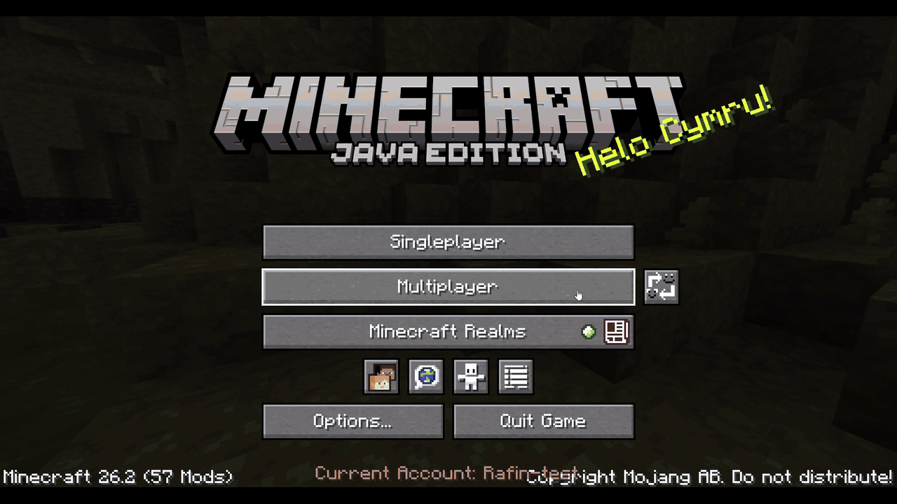

<p align="center">
  
</p>

<p align="center">
  <a href="https://modrinth.com/plugin/modseeker"><strong>Modrinth</strong></a> ·
  <a href="https://github.com/RAFIN-G/ModSeeker/releases"><strong>GitHub releases</strong></a> ·
  <a href="#compatibility">Compatibility</a> ·
  <a href="#getting-started">Getting started</a> ·
  <a href="#building-from-source">Build from source</a>
</p>

ModSeeker is a Paper plugin for checking players' mods and launchers. It works with **Hidder** to block unwanted mods, check approved mod files, and apply optional launcher restrictions.

<table>
  <tr>
    <td align="center" width="50%" valign="top">
      
      <h3>Mod detection</h3>
      <p>Block specific mods by ID, or allow only approved mod files. Checks include mods declared inside other mod JARs.</p>
    </td>
    <td align="center" width="50%" valign="top">
      
      <h3>Client &amp; launcher detection</h3>
      <p>Choose which detected launchers can join, and whether to accept unknown launchers.</p>
    </td>
  </tr>
</table>

<table>
  <tr>
    <td align="center" width="96" style="border: 1px solid #3d444d;">
      <a href="https://modrinth.com/mod/hidder"></a>
    </td>
    <td style="border: 1px solid #3d444d;">
      <h3>Hidder is required</h3>
      <p>Java players need the Hidder build for their Minecraft version, together with Fabric Loader and Fabric API. Hidder supports <strong>Windows x64</strong>.</p>
      <p><a href="https://modrinth.com/mod/hidder"><strong>Get Hidder on Modrinth →</strong></a> · <a href="https://github.com/RAFIN-G/Hidder">Hidder source</a></p>
    </td>
  </tr>
</table>

## Features

| Feature | Description |
| --- | --- |
| **Mod list viewing** | Inspect a player's reported mods. |
| **Mod blacklist** | Block unwanted mods by ID. |
| **Hash allowlist** | Approve specific mod files in advanced mode. |
| **Launcher restrictions** | Choose which detected launchers can join. |
| **Web panel** | Manage your blacklist or allowlist in a browser. |
| **Discord alerts** | Get updates on joins, mod reports, violations and verification failures. |
| **Player whitelist** | Let selected players bypass verification. |
| **Floodgate support** | Optionally bypass verification for Bedrock players identified by Floodgate. |

## In action

Block a mod in the web panel and enforce the rule when the player reconnects.

[](docs/assets/mod-policy-demo.gif)

## Compatibility

| Paper server family | ModSeeker build |
| --- | --- |
| **1.21.x** | Java 21 |
| **26.x** | Java 25 |

## Getting started

1. Put the appropriate ModSeeker JAR in your Paper server's `plugins/` directory.
2. Have verified Java players install the matching **Hidder**, **Fabric Loader** and **Fabric API** versions.
3. Start the server to generate ModSeeker's configuration and data files.
4. Choose your mod policy in `plugins/ModSeeker/config.yml`. Mod-ID verification is enabled by default; launcher verification is optional.
5. Use `/modseeker reload` after configuration changes. To open the browser panel, run `modseeker gui` in the **server console** and follow the printed link.

All ModSeeker commands require operator permissions by default. To give a trusted staff member access, grant `modseeker.admin` or individual `modseeker.command.<subcommand>` permissions. The GUI command is console-only.

Mod lists are logged to the server console by default. Set `showModList: false` to turn this off. Admins can also inspect a player's cached list with `/modseeker seek mod <player>`.

<details>
<summary>Browser panel access</summary>

By default the panel is local to the server. Its two settings are `gui.port` and `gui.externalUrl`.

- **Local:** leave `externalUrl` blank; `port: 0` selects an available local port.
- **Direct LAN/public access:** use a separate fixed port and an address such as `http://YOUR_REAL_PUBLIC_IP:PORT`. Allow that TCP port through your firewall and container/router mappings.
- **HTTPS domain:** set an address such as `https://panel.example.com` and use a same-host HTTPS reverse proxy to the panel's fixed local port.

The panel uses a different port from Minecraft. A public HTTP connection is unencrypted; use HTTPS for protected remote access. Keep the expiring access link private.

</details>

## Building from source

<details>
<summary>Build ModSeeker and Hidder together</summary>

`StartCustomBuild.ps1` builds **both the ModSeeker server plugin and the Hidder client mod**, including Hidder's native DLL. You need both source repositories, even if you started from only one project's page.

Build on **Windows x64** with **JDK 25** and the following native dependencies:

| Software | What to install |
| --- | --- |
| [Visual Studio Build Tools](https://visualstudio.microsoft.com/downloads/#build-tools-for-visual-studio) | Select **Desktop development with C++**, including the MSVC x64 tools. |
| [Windows SDK](https://learn.microsoft.com/en-us/windows/apps/windows-sdk/) | Install through the Build Tools installer or separately. |
| [OpenSSL 3.x](https://github.com/openssl/openssl) | Provide the headers and x64 static `libcrypto` libraries built with `/MT`. |

The OpenSSL directory must contain `include/openssl/` and `lib/VC/x64/MT/libcrypto_static.lib`. A runtime-only OpenSSL package is not sufficient. To build OpenSSL from source, see its [Windows build instructions](https://github.com/openssl/openssl/blob/master/NOTES-WINDOWS.md); that process also uses [Strawberry Perl](https://strawberryperl.com/) and [NASM](https://www.nasm.us/).

Gradle is included through the wrapper. Git is optional when downloading the source as ZIP files. Players installing the release JARs do not need these build tools.

The default native compiler is MSVC. Optional obfuscated builds require a Windows OLLVM-enabled `clang-cl.exe`, supplied through `-ClangCl`. It must support the obfuscation options in Hidder's native build script; standard LLVM `clang-cl` alone does not provide those passes.

For an OLLVM 16 reference implementation, see [source and build instructions](https://github.com/wwh1004/ollvm-16) or its [compiler downloads](https://github.com/wwh1004/ollvm-16/releases). Obtain or build the compiler separately; it is not bundled with these repositories.

Place the repositories next to each other as `ModSeeker/` and `Hidder/`, then run this from the folder containing both:

```powershell
.\ModSeeker\Tools\StartCustomBuild.ps1
```

On its first run, the tool creates the keys Hidder uses to sign client reports. It builds both projects, checks that ModSeeker recognizes Hidder's key, and saves the JARs in `dist/custom-pair/`. Later builds reuse those keys. The source defaults to Minecraft 26.3 / Java 25.

To initialize the keys without building:

```powershell
.\ModSeeker\Tools\StartCustomBuild.ps1 -InitializeKeysOnly
```

Keep a secure backup of `Hidder/native/client_keys.generated.inc` so future builds can use the same keys. This file contains private key material and must not be published. Each ModSeeker server generates its own separate encryption keys on first startup.

If a dependency is not found automatically, pass its location with `-JdkDirectory`, `-OpenSslDirectory`, `-VcTools` or `-WindowsSdk`. Use the two generated JARs together.

</details>

## Licence

Original ModSeeker code is licensed under [AGPL-3.0-or-later](LICENSE).

### Third-party licences

- The browser panel's **VT323** font is distributed under the [SIL Open Font License 1.1](src/main/resources/gui/OFL.txt).
- The **Gradle Wrapper** is distributed under [Apache-2.0](LICENSES/Apache-2.0.txt). Dependency licences remain with their respective projects.
